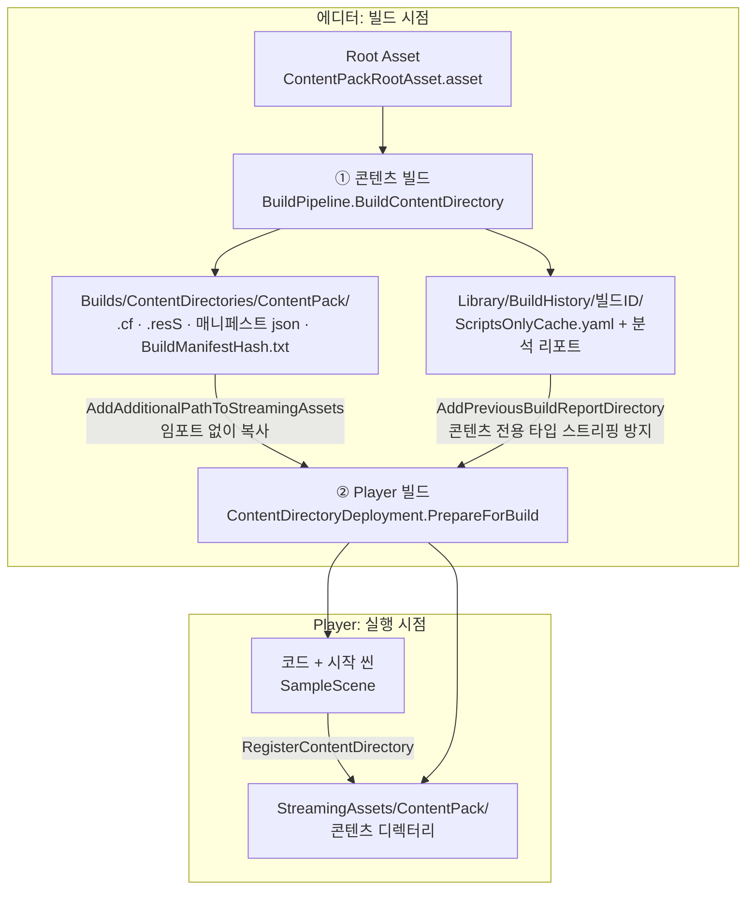
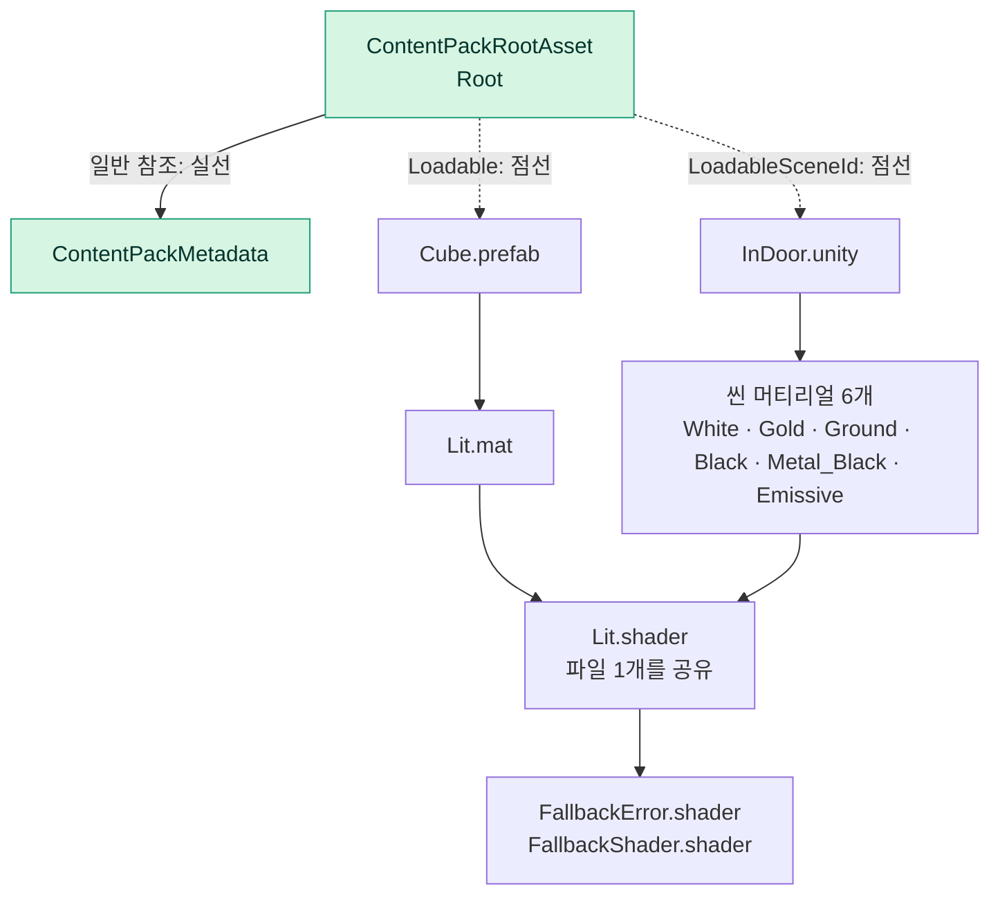
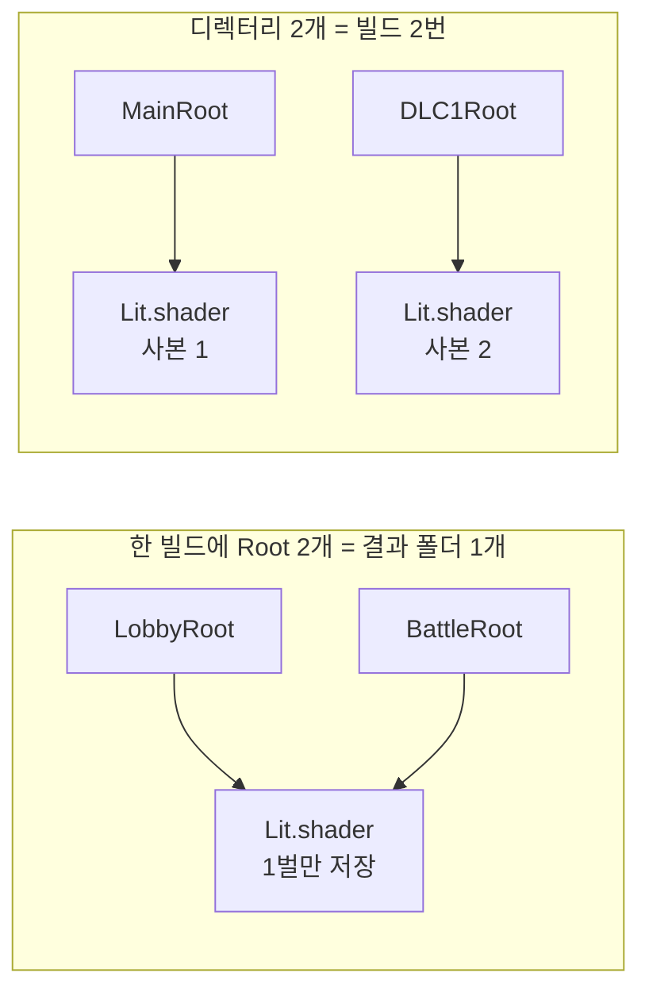
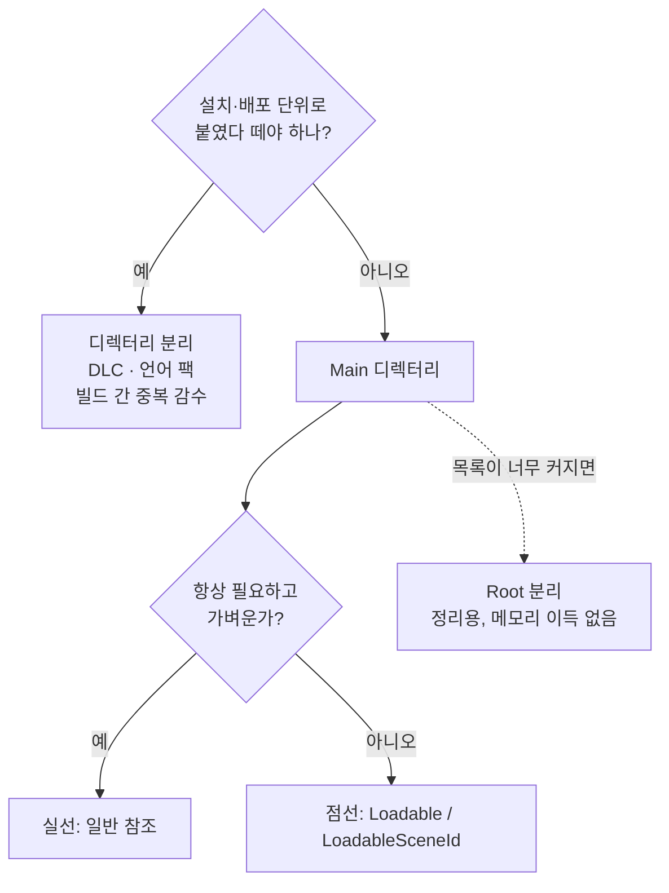
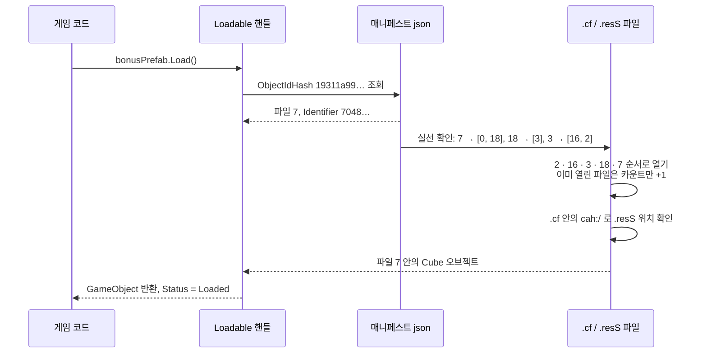
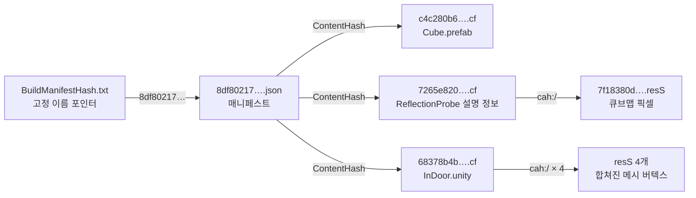
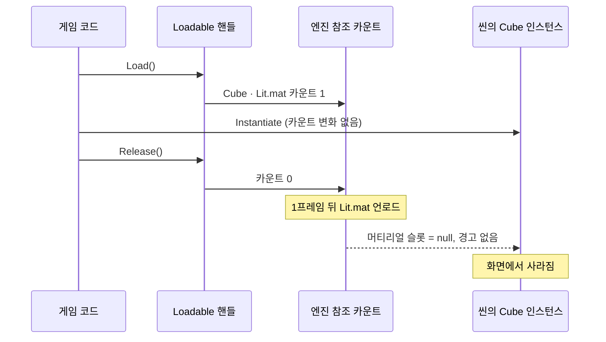
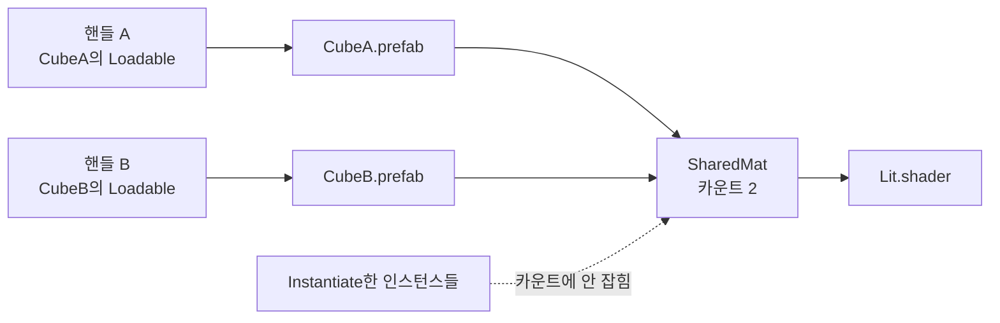
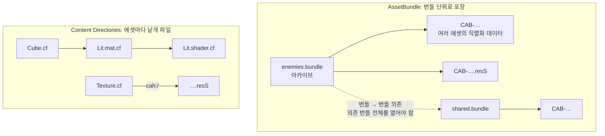
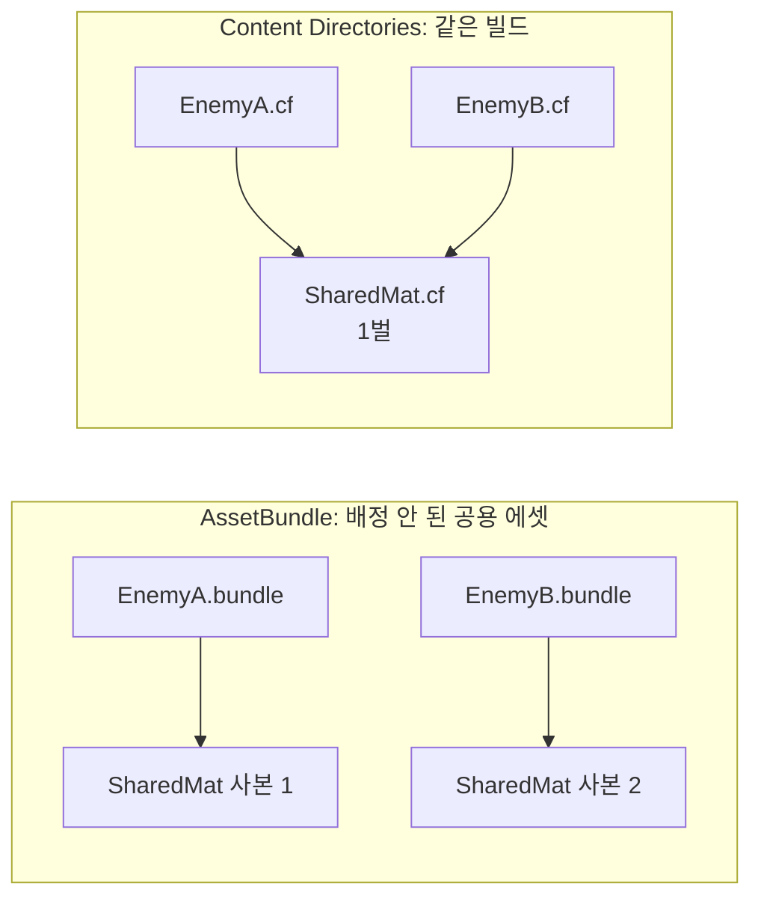

# Unity 6.6 Content Directories 학습 보고서

Unity 6.6에서 AssetBundle을 대체하려고 도입된 **Content Directories**를 공식 문서대로 직접 구현하고, 빌드 산출물과 런타임 동작을 **에디터와 Player 양쪽에서 실측**해서 설계 의도, 이득, 한계를 정리한 문서입니다.

| 항목 | 내용 |
|---|---|
| 에디터 | Unity `6000.6.3f1`, URP `17.6.0`, Input System `1.20.0`(새 Input System만 활성) |
| 빌드 타깃 | `StandaloneWindows64` (Development Build) |
| 진행 범위 | 생성 → 빌드 → 런타임 로딩 → Player 배포·검증 완료. 코드 스트리핑 비교 실험과 Addressables 변환은 미진행 |
| 표기 | **실측**: 이 프로젝트에서 직접 측정 / **문서**: 공식 문서에 명시 / **블로그**: Unity 공식 블로그 "Content directories: Beyond the AssetBundle"(George Ing, 2026-09-22)에 명시 / **추정**: 근거로부터 추론 |

---

## 목차
1. [요약](#1-요약)
2. [Content Directories란](#2-content-directories란)
3. [핵심 개념: Root와 참조 그래프](#3-핵심-개념-root와-참조-그래프)
4. [빌드: 그래프 수집과 산출물](#4-빌드-그래프-수집과-산출물)
5. [런타임 API와 설계 의도](#5-런타임-api와-설계-의도)
6. [에디터 실험 결과](#6-에디터-실험-결과)
7. [Player 검증 결과](#7-player-검증-결과)
8. [참조 카운트 규칙 (확정)](#8-참조-카운트-규칙-확정)
9. [AssetBundle과의 비교](#9-assetbundle과의-비교)
10. [한계점 정리](#10-한계점-정리)
11. [미확인 항목](#11-미확인-항목)
12. [프로젝트 구조와 재현 방법](#12-프로젝트-구조와-재현-방법)
13. [참고 문서](#13-참고-문서)

---

## 1. 요약

- **무엇인가**: 게임 데이터를 Player 밖의 폴더로 빌드하고, 실행 중에 **에셋 단위**로 로드·해제하는 엔진 내장 시스템. AssetBundle이 번들 하나에 묶어 두었던 "정리 / 파일 / 로드·해제" 단위를 **Root / 디렉터리 / `Loadable`** 로 분리했다.
- **빌드**: Root에서 GUID 참조를 재귀적으로 따라가 에셋을 모으고, 에셋 하나를 해시 이름의 파일 하나로 저장한다. 같은 빌드 안에서는 자동으로 중복이 제거된다. 변경 없는 재빌드는 64.9초 → 8.9초(실측).
- **런타임**: 등록하면 Root와 실선 의존성만 올라오고(Direct 6.93 KB / Total 2.85 MB), 점선(`Loadable`, `LoadableSceneId`)은 필요할 때 로드한다. 해제는 **핸들 단위 참조 카운트**이고 마지막 참조가 사라진 **1프레임 뒤** 언로드된다(에디터·Player 동일, 실측).
- **파일 구조**: AssetBundle과 같은 직렬화 포맷(직렬화 파일 + `.resS`)이지만 번들로 묶지 않고 에셋마다 낱개 파일로 둔다. "무엇을 열지"는 json 매니페스트(파일 → 파일 실선, 해시 파일 이름), "연 파일의 내용과 포인터 연결"은 `.cf`가 담당한다(실측).
- **가장 큰 한계**: 로컬 전용(원격 배포·패치 없음), 빌드끼리 중복 제거 불가, 그리고 **`Instantiate`한 인스턴스는 참조로 세지 않아서** 사용 중에 해제하면 머티리얼이 경고 없이 null이 되어 인스턴스가 사라지거나(GPU Resident Drawer 켬) 마젠타로 보인다(끔)(실측).
- **결론**: 로컬 콘텐츠에 한해서는 AssetBundle의 빌드 내 중복, 번들 단위 과보유, 수동 의존 관리 문제를 구조적으로 해결했다. 원격 배포가 필요하면 현재(6.6)는 AssetBundle(Addressables 원격 그룹)이 필요하다. Unity는 **Unity 7 세대에 아티팩트 단위 OTA 배포와 차분 업데이트**를 계획 중이며 2027년에 더 공개한다고 밝혔다(블로그).

---

## 2. Content Directories란



| 구분 | 내용 |
|---|---|
| **왜 만들었나** | AssetBundle은 번들 하나가 배포·저장·로딩의 **나눌 수 없는 단위**이고 의존성도 **번들 단위**로 추적해서, 함께 받고 함께 로드·해제해야 하는 큰 덩어리가 된다(블로그). 그래서 번들 레이아웃을 어떻게 짜느냐가 런타임 성능과 다운로드 크기를 좌우했고(블로그), 에셋 하나를 로드해도 의존 번들 전체를 재귀적으로 열어야 했으며, 공용 에셋 중복과 "중복 방지만을 위한 번들"이 생겼다(문서). 이를 **에셋(아티팩트) 단위로 따로 식별·로드·해제**하는 구조로 바꾼 것이 Content Directories다(블로그). 자세한 내용은 [2.1](#21-unity가-밝힌-설계-배경). |
| **이득** | 빌드 내 자동 중복 제거, 에셋 단위 의존성과 해제, 타입 안전한 참조(`Loadable<T>`), 증분 빌드, `UnloadUnusedAssets` 같은 전체 스캔 없이 해제(문서, 실측) |
| **단점** | 로컬 전용, 빌드끼리 중복, 런타임 수명 관리가 개발자 책임, 사용 중 해제에 대한 보호·경고 없음(문서, 실측) |

### 2.1 Unity가 밝힌 설계 배경
Unity 공식 블로그와 문서에 명시된 내용입니다.

**AssetBundle의 문제 (블로그·문서)**
| 문제 | 출처의 표현 요지 |
|---|---|
| 나눌 수 없는 단일 단위 | 번들 하나가 배포·저장·로딩의 나눌 수 없는 단위(블로그) |
| 번들 단위 의존성 | 의존성을 번들 단위로 추적해서 함께 받고·로드하고·해제해야 하는 큰 덩어리가 됨(블로그). 에셋 하나를 로드해도 그 번들과 의존 번들 전체를 재귀적으로 로드, 그 에셋이 참조하지 않는 것까지(문서) |
| 레이아웃 의존성 | 번들 레이아웃이 런타임 성능부터 다운로드 크기까지 좌우하는 핵심 요인. AssetBundle 직접 사용이든 Addressables든 동일(블로그) |
| 중복 | 참조된 콘텐츠가 여러 번들에 중복될 수 있고, 중복을 피하려고만 존재하는 번들이 생김(문서). Addressables에서도 번들 묶음을 제어하려고만 Addressable로 지정한 에셋이 있었음(Addressables 변환 문서) |
| 문자열 경로 | 참조를 문자열 경로로 로드(문서) |
| 순차 로딩 | 블로그 도식에서 AssetBundle 파이프라인은 에셋을 하나씩 읽고 역직렬화하며 GPU 업로드는 마지막에 몰리는 "Sequential"로 표시됨 |

**설계 선택 (블로그·문서)**
| 설계 | 해결하는 문제 |
|---|---|
| 개별 아티팩트(메시, 텍스처 등)를 독립적으로 식별·로드·해제 | 단일 단위 문제. 블로그는 함께 묶인 아티팩트의 "오염 없이" 로드한다고 표현 |
| 에셋 단위 의존성 추적, 빌드 내 자동 중복 제거 | 중복, 재귀 번들 로딩(문서) |
| 파일 이름 = 내용 해시(git처럼) | 중복 제거가 "네이티브 기능"이 됨(블로그) |
| 아티팩트끼리는 **안정 ID**로 참조, 매니페스트가 ID → 해시 조회표를 가짐 | B의 해시가 바뀌어도 A까지 연쇄로 바뀌지 않음(블로그) |
| 마운트(등록) 시 매니페스트를 읽어 안정 ID 의존성을 해석 | 각 아티팩트를 완전히 독립적으로 로드·해제(블로그) |
| 읽기·역직렬화 모두 완전 비동기, 잡 기반 파이프라인, GPU 업로드를 로딩 중 분산 | 로딩 대역폭과 플랫폼 비동기 읽기 API 활용(블로그) |
| 빌드를 에셋 임포트 프레임워크 위에서 수행: 에셋별 샌드박스·프로세스 분리 빌드, 결정적, 에셋 데이터베이스 캐시, 모든 코어 활용 | 빌드 시간, 증분 빌드(블로그). Unity 2023.1에 예고한 멀티프로세스 빌드와 같은 기반 |
| 파일 포맷은 2022년 DOTS에서 도입한 content file 포맷의 차세대 버전 | (블로그) |
| `Loadable<T>`: 빌드에는 포함, 호출할 때 로드. ScriptableObject와 함께 사용 | 문자열 경로 대체, 동적 메모리 관리(블로그) |
| Addressables에서 코드 변경 없이 백엔드 전환 | Player에 동봉하는 콘텐츠에 한함(블로그) |

이 프로젝트의 실측은 이 설명과 일치합니다. 해시 파일명(4.2), 안정 ID(`<GUID>.cfid`)와 `ContentHash`를 잇는 매니페스트(4.3), 에셋 단위 로드·해제(6장, 7장)를 직접 확인했습니다. 반대로 블로그와 문서 어디에도 **참조 카운트 규칙**이나 **사용 중 해제 시 동작**은 설명되어 있지 않아서, 8장의 규칙은 전부 이 프로젝트의 실측입니다.

**성능 수치 (블로그, 이 프로젝트에서는 미측정)**
Slime Rancher 2(Monomi Park, 기존 Addressables 프로젝트, 코드 변경 없이 전환). Unity 6.6 Beta(6000.6.0b10), MacBook Pro(M5 Max) 기준:

| 항목 | AssetBundle 백엔드 | Content Directories 백엔드 |
|---|---|---|
| 증분 빌드 | 32분 16초 | 3분 4초 |
| 클린 빌드 | 58분 6초 | 37분 13초 |
| Player 빌드 크기 | 4 GB | 2.88 GB |
| 로딩 시간(부팅 → 메뉴 → 게임플레이) | 45초 | 30초 |

참고로 문서는 "클린 빌드는 AssetBundle 빌드보다 느릴 수 있다"고 적고 있어서, 블로그의 클린 빌드 수치와는 방향이 다릅니다. 프로젝트 구성에 따라 달라지는 것으로 보입니다(추정).

**로드맵 (블로그)**
- 현재(Unity 6.6): Player에 동봉하는 AssetBundle의 대안. 원격 배포 메커니즘은 아직 없음(문서도 동일).
- **Unity 7 세대**: 세밀한 **OTA(무선) 배포**로 확장 예정. 모든 아티팩트를 Player에 동봉해야 하느냐는 질문에 블로그는 단호히 아니라고 답함.
  - 최신 HTTP 표준으로 대량의 리소스 요청을 다중화(multiplex)
  - 런타임이 기기에 없는 아티팩트만 정확히 판별해 그것만 로컬 저장소로 다운로드
  - 업데이트는 **아티팩트 단위**로 전파. 매니페스트가 내용 해시를 쓰므로 오래된 아티팩트를 싸게 판별하고 **차이만** 받음 → CDN 비용 절감
  - 이 프로젝트에 대해서는 **2027년에 더 공개** 예정. Unite Seoul 로드맵 발표에서도 예고됨
- 구체적인 출시 시점, 서비스 이름, 패치 API는 공개되지 않음.

즉 이 문서의 "원격 배포 불가"는 **현재(6.6) 기준의 한계**이며, 4.3에서 정리한 해시 체인 구조가 바로 그 차분 업데이트의 기반으로 예고되어 있습니다.

---

## 3. 핵심 개념: Root와 참조 그래프

### 3.1 Root Asset: 콘텐츠 빌드의 "Scene List"
Player 빌드가 **Scene List**에서 출발해 참조된 것을 담듯, 콘텐츠 빌드는 **Root Asset**(직접 만든 `ScriptableObject`)에서 출발해 닿는 것을 모두 담습니다. Root는 런타임에서 콘텐츠로 들어가는 **진입점(메뉴판)** 이기도 합니다. 파일 이름이 해시라서 경로 문자열로는 찾을 수 없기 때문입니다.

```csharp
public class ContentPackRootAsset : ScriptableObject
{
    public ContentPackMetadata metadata;     // 일반 참조 (실선)
    public Loadable<GameObject> bonusPrefab; // 지연 참조 (점선)
    public LoadableSceneId bonusLevel;       // 씬 참조   (점선)
}
```

### 3.2 참조 3종류: 실선과 점선
| 참조 | 빌드 | 런타임 |
|---|---|---|
| 일반 참조 (실선) | 포함 | 소유자와 **같이 로드** |
| `Loadable<T>` (점선) | 포함 | `Load()` 해야 로드, `Release()`로 해제 |
| `LoadableSceneId` (점선) | 포함 | `SceneManager.LoadSceneAsync`로 로드 |

이 프로젝트의 실제 참조 그래프입니다. 초록색은 **등록 시점에 로드되는 범위**(Direct 6.93 KB)이고, 나머지는 점선을 넘어갈 때만 로드됩니다.



**빌드는 실선과 점선을 전부 따라가고, 런타임 로드는 점선에서 멈춥니다.** Root 설계는 곧 "어디에 점선을 두어 로딩을 끊을지" 정하는 일이며, 원칙은 **수명이 같은 것끼리는 실선, 수명이 다른 경계에는 점선**입니다. `Loadable<T>`는 Root뿐 아니라 MonoBehaviour 필드에도 둘 수 있습니다(문서). 예: 로비 씬의 컨트롤러가 인벤토리 UI 프리팹을 `Loadable`로 들고 있다가 열 때만 로드.

### 3.3 참조는 무엇으로 찾나: GUID + fileID
`ContentPackRootAsset.asset`의 실제 저장 값(실측):
```yaml
bonusPrefab:
  m_LoadableObjectId: {fileID: 645800571622001937, loadable: 1, guid: 462de8f7fb5dac54eb97111ce3d2eda1, type: 3}
bonusLevel:
  m_SceneGUID: 988cbc230d1f5174ab9aa0a8beda1dfe
```
- `guid` = `Cube.prefab.meta`의 GUID(어느 파일), `fileID` = 프리팹 안 루트 GameObject 번호(파일 안의 어느 오브젝트)
- 씬은 파일 전체가 로드 단위라서 **GUID만** 저장
- `loadable: 1`이 "빌드에는 넣되 로드는 끊는다"는 점선 표식
- 씬 안 오브젝트끼리는 `{fileID: X}`(GUID 없음), 바깥 에셋은 `{fileID, guid, type}`. **그래프를 넓히는 것은 GUID가 붙은 참조뿐**
- GUID의 원본은 `.meta`라서 이름을 바꾸거나 옮겨도 유지되고, **`.meta`를 잃으면 참조가 끊김**

### 3.4 Root, 디렉터리, Loadable의 역할 분담
| 나누는 것 | 정하는 것 | 따로 할 수 있는 것 | 대가 |
|---|---|---|---|
| `Loadable` | **메모리** 단위 | 에셋 하나를 따로 Load/Release | Load/Release 짝 관리 |
| Root | **목차(찾는 방법)** 단위 | `GetRootAssets<T>()`로 묶음별 조회 | 메모리 이득 없음(등록 시 모든 Root와 실선이 로드) |
| 디렉터리 | **빌드·배포·등록** 단위 | 따로 빌드, 동봉 여부, Register/Unregister | 디렉터리끼리 에셋 중복 |



한 빌드에 Root가 여러 개면 방문 목록을 공유해서 중복이 없고, 디렉터리를 나누면 각자 담아서 중복됩니다. 문서는 "대부분 Root 하나로 충분하고, 선택 설치 콘텐츠 팩 같은 경우에만 늘려라"고 권합니다. 판단 기준은 **"설치·배포 단위로 붙였다 떼야 하나? → 디렉터리 분리, 아니면 한 디렉터리 + `Loadable`"** 입니다.



---

## 4. 빌드: 그래프 수집과 산출물

### 4.1 빌드 단계 (실측, `BuildLog.jsonl`)
```
Gather and collect build metadata   ① Root에서 GUID 참조를 따라가며 방문 목록 수집
Calculate build layout              ② 에셋 → 파일 배치, 실선/점선 기록
Generate build instructions         ③ 에셋별 작업 지시서 (Library/BuildInstructions/<GUID>.buildinst)
Execute instructions                ④ 직렬화, 셰이더 프리컴파일, 파일 쓰기
Generate build manifest             ⑤ 런타임용 매니페스트 생성
```
개념적으로는 **방문 목록을 둔 재귀 탐색**이며, 키가 에셋 GUID라서 같은 에셋은 한 번만 담깁니다. 이것이 "빌드 내 자동 중복 제거"입니다. 실제 알고리즘은 비공개입니다(추정).
```text
Collect(asset):
    if asset in visited: return
    visited.add(asset)
    for ref in asset의 GUID 참조(실선, Loadable, 씬 참조 전부):
        Collect(ref)
```
순환 참조는 런타임 로드 순서를 정할 수 없어서 **고리 전체를 한 덩어리로 묶고, 64 MB를 넘으면 빌드 실패**합니다(문서, `circularrefs.json`).

### 4.2 산출물 (실측)
| 파일 | 개수 | 역할 |
|---|---|---|
| `<해시>.cf` | 18 | 직렬화된 오브젝트. 에셋 하나 = 파일 하나 |
| `<해시>.resS` | 5 | 텍스처·메시 같은 대용량 데이터 |
| `<해시>.json` | 1 | 런타임 매니페스트 |
| `BuildManifestHash.txt` | 1 | 현재 매니페스트를 가리키는 고정 이름 포인터. `RegisterContentDirectory`가 가장 먼저 읽음 |

파일 이름이 **내용 해시**라서 내용이 같으면 이름도 같고, 재빌드 때 다시 쓰지 않습니다. 콘텐츠가 쓰는 셰이더(`Lit.shader`)도 콘텐츠 빌드 안에 직접 들어갑니다.

**`.cf`와 `.resS`의 관계 (실측)**
- `.cf`는 에셋 하나의 **직렬화 데이터 전체**입니다. 셰이더(897 KB), 씬(367 KB), 머티리얼, 프리팹 등 대부분의 에셋은 `.cf` 하나로 끝납니다.
- 텍스처·메시처럼 GPU로 보낼 큰 데이터가 있는 오브젝트만 **설명 정보는 `.cf`, 원시 데이터는 `.resS`** 로 나뉩니다(오디오·비디오는 `.resource`, 문서). `.cf` 안에 `cah:/<resS 해시>` 문자열로 위치가 적혀 있습니다.
- 매핑 결과: `ReflectionProbe-0.exr`의 `.cf`(2,568 B) → `.resS` 1개(131,232 B), `InDoor.unity`의 `.cf` → `.resS` 4개. `.resS` 5개는 각각 정확히 한 번씩 참조되고, 나머지 16개 `.cf`는 `.resS`를 쓰지 않습니다. 즉 **큰 데이터를 가진 오브젝트 하나 = `.resS` 하나**입니다.
- 씬의 `.resS` 4개는 `Combined Mesh (root: scene)` ~ `… 4`, 즉 **정적 배칭으로 합쳐진 메시**입니다. 소스에서는 `UnityMaterialBall.fbx`를 참조하지만 빌드 때 합친 메시가 씬 소유로 만들어져서, FBX가 독립 파일로 나오지 않고 메시 크기가 씬으로 집계되었습니다.
- 이 "직렬화 파일 + resS" 구성은 AssetBundle 내부(`CAB-<hash>` + `CAB-<hash>.resS`)나 Player 데이터(`globalgamemanagers.assets.resS`)와 같은 계열입니다. 차이는 **포장 단위**(번들이라는 아카이브에 묶느냐, 에셋마다 낱개 파일로 두느냐)입니다. 파일 수가 부담되면 `BuildContentOptions.UseArchive`나 `compression`으로 `content0.archive` 하나로 묶을 수 있습니다(문서, 미실측).

**파일 4번: 스크립트 이름표(MonoScript) 모음 (실측)**
ScriptableObject와 MonoBehaviour 데이터는 `m_Script: {fileID: 11500000, guid: …}`로 자기 클래스를 가리키고, 그 대상이 MonoScript(클래스 이름, 네임스페이스, 어셈블리 정보)입니다. **코드 본체가 아니라 이름표**이며 코드는 항상 Player의 DLL에 있습니다. 파일 4번에는 Root·메타데이터 클래스, InDoor의 카메라(`FreeCamera`, `UniversalAdditionalCameraData`), 조명(`UniversalAdditionalLightData`), APV(`ProbeVolume`), 볼륨(`Volume`, `VolumeProfile`, 효과 5종)의 이름표가 모여 있고, 이 집합은 `ScriptsOnlyCache.yaml`의 `usedScripts`와 같습니다. 거의 모든 데이터가 실선으로 참조하는 작은 정보라 한 파일에 모아 처음에 열어 두는 것으로 보입니다(추정). 이름표에 해당하는 클래스가 Player에 없으면(새 클래스, 스트리핑) 데이터를 객체로 만들 수 없습니다.

### 4.3 `ContentLayout.json`과 런타임 매니페스트 (실측)
`Library/BuildHistory/<빌드ID>/ContentLayout.json`의 파일별 필드:

| 필드 | 뜻 |
|---|---|
| `SourceAssets` | 이 파일에 들어 있는 프로젝트 에셋 |
| `SerializedFileDependencies` | 이 파일을 열 때 **같이 열어야 하는 파일**(실선) |
| `LoadableDependencies` | 이 파일 안의 `Loadable` 대상(점선) |
| `LoadableSceneDependencies` | 이 파일 안의 씬 참조(점선) |

```
5  ContentPackRootAsset.asset
   SerializedFileDependencies: [4, 14]           ← 스크립트 정보(MonoScript), 메타데이터
   LoadableDependencies:       [Cube의 ObjectIdHash]
   LoadableSceneDependencies:  [Assets/Scenes/InDoor.unity]
```
런타임 매니페스트에는 파일별로 `Index, ID, IsBuiltIn, SerializedFileDependencies, ContentHash`만 있습니다. **런타임에는 실선만 필요**하고, 점선은 오브젝트 안의 `Loadable` 값과 매니페스트의 `Loadables` 표(`ObjectIdHash → 파일 번호 + Identifier`)로 찾습니다. 에디터의 `fileID`는 빌드 후 런타임용 `Identifier`로 다시 매겨집니다(`645800571622001937` → `7048807285321821040`).

**런타임 매니페스트 구조**
| 섹션 | 역할 |
|---|---|
| `RootAssets` | 등록 시 자동 로드할 Root. `GetRootAssets<T>()`의 출처 |
| `Loadables` | `ObjectIdHash` → 파일 번호 + 파일 안 `Identifier` |
| `LoadableScenes` | 씬 GUID → 파일 번호 (+ 디버깅용 `Path`) |
| `SerializedFiles` | 파일 번호 → 실선 목록 + 실제 파일 이름(`ContentHash`). `ID`(`<GUID>.cfid`)는 에셋이 같으면 빌드가 바뀌어도 같고, `ContentHash`는 내용이 바뀌면 바뀜 |
| `IsBuiltIn: true` (0번) | `Library/unity default resources`. Player에 이미 있는 엔진 내장 리소스라 콘텐츠에 복사되지 않음(Cube 기본 메시) |
| `BuiltWithTypeTrees` | 직렬화 파일에 필드 구성 정보(타입 트리)를 포함했다는 표시 |

`bonusPrefab.Load()` 흐름: `ObjectIdHash 19311a99…` → `Loadables`에서 파일 7 → `SerializedFiles[7]`의 `ContentHash`로 `c4c280b6….cf`를 열고, 실선 `[0, 18]` → 18번의 `[3]` … 순으로 엶 → 파일 7 안의 `Identifier 7048…` 오브젝트를 반환. `.resS`는 매니페스트에 없고 `.cf` 안의 `cah:/`로 찾습니다.



파일 연결은 **git과 비슷한 해시 체인**입니다: `BuildManifestHash.txt`(HEAD 포인터) → 매니페스트(tree: 이름 → 해시) → `.cf`(blob, 내용 해시가 이름) → `.resS`. 내용이 같으면 이름이 같아 재사용·무결성 보장이 쉽고, 바뀐 에셋은 새 이름 파일로 생겨서 "새 파일 → 새 매니페스트 → 포인터" 순 교체가 가능한 구조입니다(6.6에는 패치 기능 없음). 대신 해시 이름이라 사람이 읽을 수 없어 원본 경로는 `ContentLayout.json`에만 남습니다.

블로그도 이 구조를 git에 빗대어 설명합니다. 각 content file은 내용 해시로 이름 붙고, **아티팩트끼리는 해시가 아니라 안정 ID로 참조**하며, 매니페스트가 안정 ID → 내용 해시 조회표를 가집니다. 그래서 B의 해시가 바뀌어도 B를 참조하는 A의 파일 내용(과 해시)은 바뀌지 않아 **해시 변경이 연쇄로 퍼지지 않습니다**(블로그). 이 프로젝트에서 본 `.cf` 안의 `<GUID>.cfid`(안정 ID)와 매니페스트의 `ID` → `ContentHash` 매핑이 바로 그것입니다. 블로그는 이 해시 구조를 Unity 7 세대의 **아티팩트 단위 차분 업데이트** 기반으로 예고했습니다.



**실선 정보는 두 곳에 있다 (실측)**: 씬 `.cf` 안에서 추출한 외부 파일 목록(`a2a42d71….cfid`, `30441f42….cfid`, …, `Library/unity default resources`, …)을 번호로 바꾸면 `[4, 12, 15, 6, 10, 9, 1, 0, 17, 11, 8]`로, 매니페스트의 13번 실선과 **내용·순서가 완전히 같습니다.**

| | `.cf` 안의 외부 파일 목록 | 매니페스트의 실선 |
|---|---|---|
| 표기 | 파일 ID(`<GUID>.cfid`) | 파일 번호 + 해시 파일 이름 |
| 역할 | 열린 파일 안에서 포인터를 다른 파일의 실제 객체로 **연결** | 파일을 열기 **전에** 무엇을 같이 열지 결정(로딩 계획, 참조 카운트의 바탕) |

정리하면 **"무엇을 열지"는 매니페스트, "연 파일의 내용과 배선"은 `.cf`** 입니다. 블로그도 "마운트 시 로딩 시스템이 매니페스트를 읽고 안정 ID 의존성을 해석한다"고 설명합니다(블로그). 그래서 등록 시 매니페스트 하나만 읽으면 어떤 콘텐츠 파일도 열지 않고 전체 로딩 계획을 세울 수 있습니다.

### 4.3.1 결과물과 빌드 기록의 구분
| 위치 | 성격 | 내용 |
|---|---|---|
| `Builds/ContentDirectories/<이름>/` | **배포물** | `.cf`, `.resS`, 매니페스트, `BuildManifestHash.txt`. 폴더 통째로 배포(문서) |
| `Library/BuildHistory/<빌드ID>/` | **빌드 기록** | `ContentLayout.json`, `ContentSizeSummary.txt`, `BuildLog.jsonl`, `BuildReportSummary.json`, `.buildreport`, `BuildContentTEP.json`은 분석용. **`ScriptsOnlyCache.yaml`만은 Player 빌드 입력** |
| `Library/BuildInstructions/` | **증분 빌드 캐시** | `<GUID>.buildinst`. 지워도 결과는 같고 다음 빌드만 느려짐 |

`ContentLayout.json`은 Player에 들어가지 않는 **사람용 리포트**이고, 게임이 쓰는 것은 출력 폴더의 매니페스트입니다. 원본 경로 같은 정보를 배포물에서 빼고 최소 정보만 런타임에 둔 구조로 보입니다(추정).

⚠️ `ContentDirectoryDeployment`는 `BuildHistory.TryGet…`이 실패하면 **조용히 건너뜁니다.** `Library`를 지웠거나, 새로 clone했거나, CI에서 콘텐츠와 Player를 다른 작업 공간에서 빌드하면 Player 빌드는 성공하지만 **콘텐츠 전용 타입의 스트리핑 보호가 빠질 수 있습니다.** 같은 작업 공간에서 "콘텐츠 빌드 → Player 빌드" 순서를 지켜야 합니다.

### 4.4 빌드 측정 (실측)
| 항목 | 1차 빌드 | 2차 빌드(변경 없음) |
|---|---|---|
| 전체 시간 | 64,991 ms | **8,853 ms** |
| 스크립트 컴파일 | 20.9초 | 7.1초 |
| 데이터 빌드 실행 | 42.3초 | 0.5초 미만 |
| 재빌드 / 재사용 파일 | 18 / 0 | **0 / 18** |

Build Analysis(Window > Analysis > Build Analysis):

| Root | Direct Size | Direct Assets | Total Size | Total Assets |
|---|---|---|---|---|
| ContentPackRootAsset | **6.93 KB** | 2 | **2.85 MB** | 17 |

Direct 6.93 KB = Root 파일 2,268 B + 메타데이터 1,068 B + 스크립트 정보 3,756 B = 7,092 B로 정확히 일치합니다. 약 420배 차이가 점선 두 개의 효과입니다.

### 4.5 코드 스트리핑 연결: `ScriptsOnlyCache.yaml` (실측, 문서)
콘텐츠 빌드는 사용 타입 목록을 남기고, `ContentDirectoryDeployment`가 Player 빌드 때 `AddPreviousBuildReportDirectory`로 전달해 스트리핑을 막습니다.
```yaml
usedScripts:
  Assembly-CSharp.dll:
  - ContentsDirectories.ContentPackMetadata
  - ContentsDirectories.ContentPackRootAsset
  Unity.RenderPipelines.Universal.Runtime.dll:
  - UnityEngine.Rendering.Universal.ColorAdjustments        ← InDoor 볼륨에만 있음
  - UnityEngine.Rendering.Universal.ScreenSpaceLensFlare    ← InDoor 볼륨에만 있음
  ...
```
`ColorAdjustments`와 `ScreenSpaceLensFlare`는 Player의 `SampleSceneProfile`에는 없는 **콘텐츠 전용 타입**입니다. Player에서 InDoor 화면이 에디터와 같았던 것이 이 전달 덕분인지는 비교 실험을 하지 않아 미확인입니다.

---

## 5. 런타임 API와 설계 의도

API 시그니처는 설치된 에디터의 `UnityEngine.ContentLoadModule.xml`에서 확인했습니다.

| API | 동작 |
|---|---|
| `ContentLoadManager.RegisterContentDirectory(path)` | 매니페스트를 읽고 Root와 실선 의존성을 로드, `ContentDirectoryHandle` 반환. 폴더가 없으면 `FileNotFoundException` |
| `ContentLoadManager.GetRootAssets<T>()` | 등록된 디렉터리에서 타입 `T`인 Root 배열 |
| `ContentLoadManager.UnregisterContentDirectory(handle)` | 등록 해제(열린 파일이 있으면 에러 로그, 문서) |
| `Loadable<T>.Load()` / `LoadAsync()` | 동기/비동기 로드, 실패 시 `null` |
| `Loadable<T>.Release()` | 참조를 놓음 |
| `Loadable<T>.Status` / `Target` | `None`/`Loading`/`Loaded`/`Failed`, 로드 결과 |
| `SceneManager.LoadSceneAsync(LoadableSceneId, LoadSceneParameters)` | 콘텐츠 씬 로드 |
| `SceneManager.GetSceneByLoadableSceneId(id)` | 로드된 씬 조회 |

| 설계 요소 | 왜 이렇게 (추정 포함) | 이득 | 단점 |
|---|---|---|---|
| 출력 경로를 `Assets` 밖에 | 해시 파일 수천 개의 임포트 방지(문서) | 에디터 반복 속도 | StreamingAssets 복사 연결 코드 필요, 에디터·Player 경로 분기 |
| 명시적 등록 | 콘텐츠가 Player 밖에 있어 엔진이 존재를 모름. 매니페스트로 조회 표를 만듦 | 가시성·수명 통제, 폴더 단위 붙이기/떼기, 스택 순서 조회 | 동기 파일 접근(Web은 비공식 우회), 등록 시 Root+실선 일괄 로드, 해제 순서 준수 |
| 타입으로 Root 조회 | 해시 파일명이라 경로가 없음 | 이름 변경에 강함, 타입 검사 | Root 타입·필드가 Player와 콘텐츠에서 같아야 함, 에디터 Play가 빌드 누락을 가림 |
| `Loadable<T>` 핸들 | 참조 하나가 에셋 하나의 수명 손잡이 | 에셋 단위 관리, 중복 호출에 안전 | Load/Release 짝 책임, RAII 아님, 인스턴스 공유 금지 |
| 씬은 기존 `SceneManager` 확장 | 씬 고유 규칙 재사용 | 기존 워크플로 유지 | 부분 해제 불가, 상태 필드 없음, `UnloadSceneAsync(LoadableSceneId)` 없음 |
| 핸들만 세는 참조 카운트 | 모든 에셋 대입을 추적하는 비용 회피. `UnloadUnusedAssets`의 전체 스캔(예: 13개 정리에 23.32 ms) 대신 놓는 순간 그 에셋만 처리 | 예측 가능하고 비용이 해제량에 비례 | 인스턴스 사용은 보호되지 않음, 해제 완료 시점·참조 수 조회 API 없음 |

---

## 6. 에디터 실험 결과

측정 지표: 처음에는 `Resources.FindObjectsOfTypeAll<Material/Shader>()` 전체 개수, 이후에는 노이즈를 줄인 **콘텐츠 머티리얼 수**(`hideFlags == None`이고 이름이 `Hidden/`으로 시작하지 않는 머티리얼).

### 6.1 빌드 내 공유 (`ContentLayout.json`)
Cube의 `Lit.mat`(파일 18)과 InDoor 머티리얼 6개(파일 1, 6, 9, 10, 12, 15)가 **모두 파일 3번(`Lit.shader`)** 을 가리킵니다. 중복 여부를 정하는 것은 실선/점선이 아니라 **같은 빌드인가**입니다.

### 6.2 등록과 로드
| 단계 | 결과 |
|---|---|
| 등록 직후 | `Root 개수: 1`, `metadata: Hello World!`, Cube `Status: None` |
| `bonusPrefab.Load()` | 셰이더 **+3** = 파일 3, 16, 2(Lit, FallbackError, FallbackShader) |
| 씬 로드 | 콘텐츠 머티리얼 **+6**, 셰이더 **+0**(공유) |
| 같은 씬 Additive 반복 | 씬 인스턴스는 늘고 머티리얼 +0 → 에셋 공유, 씬 오브젝트만 중복 |

### 6.3 해제 순서 실험 A, B
| 실험 | 순서 | 결과 |
|---|---|---|
| A | Cube Release → 씬 언로드 | 씬 언로드 후 머티리얼 −6, 셰이더 **−3** |
| B | 씬 언로드 → Cube Release | 씬 언로드 후 셰이더 **유지**(5회 동일) → Cube Release 후 셰이더 **−3** |

공유 에셋은 **마지막 사용자가 놓을 때만** 해제됩니다. `Release()`와 씬 언로드 완료 이벤트 모두 그 시점에는 아직 메모리에 남아 있고 이후 해제됩니다.

### 6.4 콘텐츠만 센 기준선 복귀
| 시점 | 콘텐츠 머티리얼 |
|---|---|
| 등록 직후 | 9 (에디터의 일반 머티리얼) |
| Cube Load + 씬 로드 | 16 |
| Cube Release 후 | 15 |
| 씬 언로드 후 | **9** |

전체 개수에 남은 +8은 `Hidden/Universal Render Pipeline/…`(`HideAndDontSave`) **URP 내부 머티리얼**로, 콘텐츠 관리 범위 밖입니다. URP가 이 머티리얼을 파괴·재생성하기 때문에(추정) 객체 기준 비교는 교체분까지 "추가"로 잡혔습니다.

### 6.5 E3: 같은 핸들로 Load 2회
| 단계 | +0프레임 | +1프레임 | Status |
|---|---|---|---|
| `Load()` ×2 | 10 | 10 | `Loaded`, 두 결과 같은 객체 |
| `Release()` 1회 | 10 | **9** | `None` |
| `Release()` 2회 | 9 | 9 | `None`, 에러 없음 |

### 6.6 E3b: 같은 에셋, 다른 핸들 2개
| 단계 | +1프레임 | 원본 / 두 번째 |
|---|---|---|
| 두 핸들 `Load()` | 10 | `Loaded` / `Loaded`, 같은 객체 |
| 원본만 `Release()` | **10 유지** | `None` / `Loaded` |
| 두 번째도 `Release()` | **9** | `None` / `None` |

### 6.7 E1′: 해제된 것을 계속 쓰면
| 시점 | 원본 프리팹 | 씬의 인스턴스 | 인스턴스 머티리얼 | 콘텐츠 |
|---|---|---|---|---|
| Release +0프레임 | 정상 | 정상 | `Lit` | 10 |
| Release +1프레임 | **가짜 null** | **살아 있음** | **진짜 null**(접근 시 `NullReferenceException`) | **9** |
| 화면 | | **Cube가 사라짐(분홍색 아님)** ※ GPU Resident Drawer가 켜진 이 프로젝트 기준. GRD를 끄면 마젠타(7.4 CD6) | | |
| 해제된 원본으로 `Instantiate` | `MissingReferenceException: The object of type 'UnityEngine.GameObject' has been destroyed…` | | | |



### 6.8 기타 관찰
- 빌드 경고 `Fallback fonts are not supported in content directory builds.` → UI 폴백 폰트 제외
- FBX 메시(`UnityMaterialBall.fbx`)가 독립 파일이 되지 않고 씬 파일 쪽에 합쳐져 집계됨(규칙 미확인)
- `UnloadSceneAsync`에 `LoadableSceneId` 오버로드가 없음(컴파일 에러 CS1503)
- 같은 씬 중복 로드 방지는 `GetSceneByLoadableSceneId(id).isLoaded`로 가능하지만, 비동기 로드 중에는 `false`라 연타 시 빈틈이 있음

---

## 7. Player 검증 결과

Development Build로 `Builds/Player/`에 빌드하고 `%USERPROFILE%\AppData\LocalLow\DefaultCompany\ContentDirectoriesStudy\Player.log`로 확인했습니다.

### 7.1 배포
`Builds/Player/ContentDirectoriesStudy_Data/StreamingAssets/ContentPack/`의 25개 파일이 에디터 쪽 `Builds/ContentDirectories/ContentPack/`과 **`diff` 결과 완전히 동일**했습니다(매니페스트 해시 `8df80217…` 동일). `AddAdditionalPathToStreamingAssets`가 임포트 없이 복사합니다. Player에서는 `ContentDirectoryManager`의 `#else` 분기(`Application.streamingAssetsPath`)로 정상 등록되었습니다.

### 7.2 에디터와 비교
| 항목 | 에디터 | Player |
|---|---|---|
| 전체 Material / Shader (M1) | 400~500 / 141 | **6 / 51** |
| 콘텐츠 머티리얼 기준선 | 9 | **2** |
| Cube Load | +1 | **+1** |
| 씬 로드 | +6 | **+6** |
| Cube Release | −1 | **−1** |
| 씬 언로드 후 | 기준선 복귀 | **기준선 복귀** |
| `UnloadUnusedAssets` 없이 해제 | 됨 | **됨** |
| E3 (2회 반복) | 핸들별, 1프레임 지연, 중복 Release 안전 | **동일** |
| E3b | 핸들마다 1개, 객체 공유 | **동일** |
| E1′ 수치 | 원본 가짜 null, 머티리얼 null, −1 | **동일** |
| E1′ 화면 (GRD 켬) | Cube 사라짐 | **Cube 사라짐** (GRD 끄면 마젠타, CD6) |
| E1′ 해제된 원본 재사용 에러 | `MissingReferenceException`("이미 파괴됨") | **`ArgumentNullException: Value cannot be null. Parameter name: data`** |
| InDoor 포스트 효과(렌즈 플레어, 색 보정) | 기준 | **동일** |

**동작 규칙은 에디터와 Player가 같고, 다른 것은 기준선 숫자와 해제된 객체 재사용 시의 에러 종류뿐**입니다. Player의 에러 메시지는 원인을 떠올리기 더 어렵습니다.

### 7.3 Player에서 추가로 알게 된 것
- `Start()`는 첫 렌더링 전이라, 그 직후 URP가 내부 머티리얼·셰이더를 만들면서 전체 개수가 크게 늘어남(M1 6 → M2 66). 기준선은 **첫 프레임 이후**에 찍어야 함.
- `Shader 'Hidden/Universal Render Pipeline/GaussianDepthOfField' is not supported or has been stripped from the build …` 등 DoF·Panini 스트리핑 경고. 두 볼륨 프로파일 모두 쓰지 않는 효과라 영향 없음.
- 코드만 바꾸면 **Player만** 다시 빌드하면 되고 콘텐츠는 재사용됨. 반영 여부는 `ContentDirectoriesStudy.exe`가 아니라 `ContentDirectoriesStudy_Data/Managed/Assembly-CSharp.dll`의 시각으로 확인해야 함(exe는 실행용 껍데기).

---

### 7.4 블로그용 추가 측정 (CD1~CD4, 배치 모드 자동 측정)
에디터를 열지 않고 Unity 배치 모드로 빌드하고, Player를 `-cdmeasure` 인자로 실행해 `CdMeasureRunner`가 자동으로 측정했습니다. 두 Player 모두 **Managed Stripping Level = High**, Development Build이며, 차이는 `ScriptsOnlyCache.yaml` 디렉터리 전달 여부뿐입니다. 원본 로그는 `measurements/`에 있습니다.

| Player | 크기 | 스트리핑 정보 전달 |
|---|---|---|
| `Builds/Measure/Normal` | 916,173,710 B | 전달함(정상) |
| `Builds/Measure/NoReport` | 915,978,811 B (−194,899 B) | 전달 안 함 |

#### CD1: `Resources.UnloadUnusedAssets()`가 콘텐츠 에셋을 내리는가 → **내리지 않음**
`Instantiate`도 C# 참조도 없이 **핸들만** 잡은 상태에서 호출했습니다(콘텐츠 머티리얼 = `hideFlags None`이고 `Hidden/`이 아닌 머티리얼).

| 단계 | 콘텐츠 머티리얼 | 비고 |
|---|---|---|
| 기준선 | 2 `[Default-Skybox, Sprites-Default]` | |
| Cube 핸들만 `Load()` | 3 (+`Lit`) | `Status=Loaded` |
| `UnloadUnusedAssets()` | **3 유지** | `Unloading 0 unused Assets`, `Status=Loaded`, `Target==null: False` |
| Cube `Release()` | 2 | |
| Gold 핸들(`Loadable<Material>`)만 `Load()` | 3 (+`Gold`) | |
| `UnloadUnusedAssets()` | **3 유지** | `Unloading 0 unused Assets` |
| Gold `Release()` | 2 | |

`UnloadUnusedAssets`는 이 상태에서 1~2 ms(약 2,500개 오브젝트 스캔)였고, **콘텐츠 핸들이 잡은 에셋은 "사용 중"으로 취급**했습니다. 두 Player 결과 동일.

#### CD2: `Loadable<Material>`과 씬의 같은 머티리얼은 같은 객체인가 → **같은 객체, 참조도 합산**
| 순서 | 단계 | 콘텐츠 머티리얼 | 결과 |
|---|---|---|---|
| 1 | InDoor 씬 로드 | 8 (+6) | 씬의 Gold `EntityId 2644:256` |
| 1 | Gold 핸들 `Load()` | **8 (+0)** | `same=True`, 같은 `EntityId` |
| 1 | 씬 언로드 | **3** | Gold만 남음(핸들이 잡고 있음) |
| 1 | Gold `Release()` | 2 | |
| 2 | Gold 핸들 `Load()` 먼저 | 3 | |
| 2 | 씬 로드 | 8 | `same=True` |
| 2 | Gold `Release()` (씬 유지) | **8** | 씬이 쓰고 있어 유지 |
| 2 | 씬 언로드 | 2 | |

같은 빌드 안에서는 **어느 경로로 로드해도 객체는 하나**이고, 씬과 핸들이 각각 참조를 가집니다. 8장의 규칙(마지막 사용자가 놓을 때 해제)이 머티리얼 단위에서도 그대로 성립합니다.

#### CD3: `ScriptsOnlyCache` 전달을 끄면 스트리핑으로 깨지는가 → **패키지 타입이 지워져 "스크립트 없음" 경고**
첫 측정의 확인 코드가 `Type.GetType("…")`에 **상수 문자열**을 쓰고 있었는데, UnityLinker가 이런 리플렉션 패턴을 보고 해당 타입을 남길 수 있어서 측정 자체가 결과에 영향을 줄 수 있었습니다. 그래서 타입 이름을 런타임에 만들어 쓰도록 고쳐 **다시 측정**했고(아래가 재측정 값), 결과는 첫 측정과 같았습니다.

| 항목 | Normal | NoReport |
|---|---|---|
| InDoor 씬 로드 시 경고 | 없음 | `The referenced script (UnityEngine.Rendering.FreeCamera) on this Behaviour is missing!`<br/>`The referenced script (UnityEngine.Rendering.ProbeVolume) on this Behaviour is missing!` (로드할 때마다) |
| `FreeCamera`, `ProbeVolume` 타입 (SRP Core 패키지) | 존재 | **없음 (스트리핑됨)** |
| `Rotator` (Assembly-CSharp, Cube에만 붙임) | 존재, 동작 | **존재, 동작** |
| `ColorAdjustments`, `ScreenSpaceLensFlare` 타입 | 존재 | 존재 (비교 대상 아님, 아래 참고) |

- **콘텐츠에서만 쓰는 패키지 타입**(`FreeCamera`, `ProbeVolume`)은 정보 전달이 없으면 **스트리핑되어 컴포넌트가 빠집니다.** 빌드는 성공하고 런타임에 경고만 남습니다. `ProbeVolume`이 빠지면 APV 간접 조명이 동작하지 않을 것으로 보이지만 화면 비교는 미실측입니다.
- **직접 만든 `Rotator`는 전달 없이도 남았습니다.** 매뉴얼의 루트 마킹 규칙(Medium·High)에 "사용 중인 스크립트 어셈블리의 MonoBehaviour·ScriptableObject 파생 타입은 모두 보존"한다는 항목이 있어서, Assembly-CSharp가 Player에서 쓰이는 한 이 결과와 맞습니다.
- 다만 **같은 규칙이 패키지 어셈블리도 포함한다고 적혀 있는데, 실측에서는 패키지의 MonoBehaviour(`FreeCamera`, `ProbeVolume`)가 지워졌습니다.** 문서 표와 실제 동작이 다르고, 원인은 확인하지 못했습니다.
- `ColorAdjustments`, `ScreenSpaceLensFlare`는 URP의 후처리 코드가 이 타입들을 직접 참조하고 있을 가능성이 커서(추정) 콘텐츠 전용 여부를 판단하는 비교 대상으로 쓸 수 없습니다.
- 정리: **"직접 만든 스크립트는 남고, 콘텐츠에서만 쓰는 패키지·엔진 타입이 지워진다."** 그래서 직접 만든 스크립트만 보고 "전달 없이도 괜찮다"고 판단하면 안 됩니다.

#### CD4: Addressables 4.1.1에서 Content Directory 그룹과 AssetBundle 그룹을 섞으면 → **공유 의존성이 양쪽에 각각 빌드됨**
`measure/cd4-addressables` 브랜치에서 측정했습니다(main에는 Addressables를 설치하지 않음).
- 구성: `CD_Group`(`ContentDirectoryGroupSchema`)에 Cube, `AB_Group`(`BundledAssetGroupSchema`, 무압축)에 CubeB(같은 `Lit.mat` 사용), 빌더는 `BuildScriptSchemaDriven`
- 결과: 빌드 13.1초, 같은 출력 폴더에 `content0.archive`(211,488 B, 기본 LZ4 아카이브)와 `ab_group_assets_all_….bundle`(451,392 B)

| 공유 의존성 | 콘텐츠 디렉터리 (`ContentLayout.json`) | AssetBundle (`buildlayout`) |
|---|---|---|
| `Lit.mat` | 포함 | 포함 |
| `Lit.shader` | 포함 | 포함 |
| `FallbackError.shader` / `FallbackShader.shader` | 포함 | 포함 |

- 문서의 경고("공유 의존성이 두 번 빌드된다")가 **실측으로 확인**됐습니다.
- 크기는 비교하지 않습니다. 두 리포트의 크기 값은 재는 기준이 다르고(콘텐츠 쪽 `ContentSizeSummary` 대 Addressables `buildlayout`의 `SerializedSize`), 셰이더 변형 구성도 빌드마다 달라질 수 있어서 같은 표에 놓으면 오해를 부릅니다. 측정 근거 파일에는 원값을 그대로 남겨 두었습니다.
- Addressables 빌드 레이아웃의 **`DuplicatedAssetCount`는 0**이었습니다. 콘텐츠 디렉터리와 AssetBundle 양쪽에 같은 셰이더가 들어갔는데도 0이므로, **콘텐츠 디렉터리와의 중복은 이 리포트에 잡히지 않습니다.** 이 구성에는 AssetBundle이 하나뿐이라 번들끼리의 중복을 어떻게 세는지는 이번 측정으로 알 수 없습니다.
- 덤: Addressables는 콘텐츠 디렉터리용 Root를 **자동 생성**합니다(`Library/BuildInstructions/ContentDirectoryRootAssets/AddressableRootAsset.asset`). Addressables 사용자는 Root Asset을 직접 만들 필요가 없습니다.

#### CD4b: Convert schema로 바꾼 그룹을 기존 Addressables 로드 코드로 그대로 로드할 수 있는가 → **가능 (단, 빌드 스크립트 조건 있음)**
`measure/cd4-addressables` 브랜치, 근거는 `measurements/cd4b_convert_runtime.log`.
- 런타임 코드(`CdAddressablesRunner`)는 평범한 Addressables 코드입니다: `LoadAssetAsync<GameObject>("Cube")` → `Instantiate` → `Release`, 그리고 `InstantiateAsync("Cube")` → `ReleaseInstance`. **세 단계 모두 이 코드를 그대로** 썼습니다.
- 변환은 Groups 창의 "Convert schema(s) to Content Directory"가 호출하는 패키지 코드(`ConvertGroupToContentDirectory`)와 같은 처리를 스크립트로 했습니다: `BundledAssetGroupSchema`는 **지우지 않고 비활성화**, `ContentDirectoryGroupSchema`를 추가해 빌드·로드 경로를 이어받고 활성화, 기본 빌드 경로의 AssetBundle 삭제.

| 단계 | 그룹 / 빌드 스크립트 | 빌드 결과 | Player 실행 결과 |
|---|---|---|---|
| A | AssetBundle 그룹 / `BuildScriptSchemaDriven`("Default Build Script") | 번들 2개 | 로드 성공. 위치 `BundledAssetProvider` + 의존 `AssetBundleProvider`(`conv_group_assets_all_….bundle`) |
| **B** | 변환한 그룹 / `BuildScriptSchemaDriven`("Default Build Script") | 번들 0, **콘텐츠 디렉터리 1**(`content0.archive`) | **로드 성공.** 위치 `NativeContentAssetEntryProvider`, 의존 없음 |
| B0 | 변환한 그룹 / `BuildScriptPackedMode`("Build Script (AssetBundles)") | **번들 0, 콘텐츠 디렉터리 0, 에러 없음** | **실패**: `InvalidKeyException … No Location found for Key=Cube` |

A와 B의 런타임 결과는 같았습니다. 컴포넌트 `[Transform, MeshFilter, MeshRenderer, BoxCollider, Rotator]`, 머티리얼 `Lit/Universal Render Pipeline/Lit`, 콘텐츠 머티리얼 2 → 3 → `Release` 후 2, `InstantiateAsync` 후 3 → `ReleaseInstance` 후 2. 바뀐 것은 Addressables 내부의 **위치(로케이션) 공급자뿐**입니다.

- **"코드 변경 없이 전환"은 로컬 그룹 + Default Build Script 조건에서 실측으로 확인**됐습니다.
- 함정: 4.1.1에서 UI 이름 "Default Build Script"는 `BuildScriptSchemaDriven`이고, `BuildScriptPackedMode`의 이름은 "Build Script (AssetBundles)"입니다(그런데 `BuildScriptPackedMode`의 `CreateAssetMenu` 경로는 ".../Default Build Script"라 헷갈립니다). 활성 빌더가 AssetBundle 전용이면 변환된 그룹은 **경고 없이 아무것도 빌드되지 않고**, 런타임에서야 키를 못 찾습니다. 새로 만든 4.1.1 설정은 `BuildScriptSchemaDriven`을 활성으로 지정합니다(패키지 소스 확인). 2.x에서 올린 기존 프로젝트의 활성 빌더가 어떻게 되는지는 확인하지 못했습니다.
- 참고: 측정 초기 코드(`yield return` 초기화 핸들)로는 A Player가 초기화 단계에서 2회 멈췄고, 완료를 프레임마다 확인하는 코드로 바꾼 뒤에는 정상이었습니다. 원인은 확인하지 못했고, 위 결과는 모두 바꾼 코드로 A와 B를 다시 빌드해 잰 값입니다.

#### CD6: E1′의 "사라짐"은 GPU Resident Drawer 때문인가 → **그렇다. GRD를 끄면 마젠타로 보임**
E1′(인스턴스가 살아 있는데 핸들만 `Release`)을 Player에서 재현하고, Cube 중심 픽셀을 `ScreenCapture.CaptureScreenshotAsTexture()`로 기록했습니다. GRD는 `-grd off` 인자일 때 첫 렌더 전에 `UniversalRenderPipelineAsset.gpuResidentDrawerMode = Disabled`로 바꿨습니다. 이 프로젝트의 기본값은 `PC_RPAsset`의 `InstancedDrawing`(켜짐)입니다.

| 조건 | Release 전 중심 픽셀 | Release 후 중심 픽셀 | 화면 |
|---|---|---|---|
| Normal, GRD 켬(기본) | rgb(144,137,134) Cube | rgb(204,216,216) **배경** | Cube가 사라짐 |
| Normal, **GRD 끔** | rgb(142,135,132) Cube | **rgb(209,1,209) 마젠타** | Cube가 분홍색으로 보임 |
| NoReport, GRD 켬 | rgb(144,136,133) Cube | rgb(204,216,216) 배경 | Cube가 사라짐 |

- 세 경우 모두 Release 후 `sharedMaterial == null: True`, `renderer.enabled: True`로 **데이터 상태는 같고, 그리는 방식만 다릅니다.**
- 즉 6.7과 7.2에서 "분홍색이 아니라 사라진다"고 적은 것은 **GRD가 켜진 이 프로젝트 설정에서의 결과**였습니다. GRD가 꺼진 프로젝트에서는 일반적인 "머티리얼 없음" 표시(마젠타)가 나옵니다. GRD가 null 머티리얼 렌더러를 그리기 대상에서 빼는 것으로 보이지만 내부 이유는 확인하지 못했습니다(추정).
- 스크린샷: `measurements/cd56/CD6_before_*.png`, `CD6_after_*.png`

#### CD5: 스트리핑 정보를 안 넘기면 APV 간접 조명이 깨져 보이는가 → **이 프로젝트로는 판단 불가 (차이는 잡음 수준)**
Normal과 NoReport Player에서 InDoor 씬을 씬 자체 카메라로 찍어 픽셀 단위로 비교했습니다(둘 다 GRD 켬, 960×540).

| 비교 | 평균 차이 | 차이 > 8인 픽셀 |
|---|---|---|
| 같은 빌드 반복: Normal 1회 vs 2회 | 0.136 | 0.038% |
| 같은 빌드 반복: NoReport 1회 vs 2회 | 0.255 | 0.560% |
| Normal vs NoReport (1회끼리) | 0.328 | 0.533% |
| Normal vs NoReport (2회끼리) | 0.181 | 0.092% |

- NoReport에서는 `ProbeVolume` 컴포넌트가 실제로 빠졌지만(`missingScripts=2`, 타입 목록에서 `FreeCamera`, `ProbeVolume` 없음), 두 빌드의 차이는 **같은 빌드를 반복해서 찍은 차이와 같은 수준**이었습니다. 평균 밝기도 153.92~154.07로 같습니다.
- 다만 이 프로젝트의 `PC_RPAsset`은 `m_LightProbeSystem: 0`(Light Probe Groups)이라 **APV를 쓰지 않습니다.** 그래서 `ProbeVolume`이 지워져도 영향이 없는 게 당연하고, "APV를 쓰는 프로젝트에서 깨지는가"는 이 측정으로 답할 수 없습니다. 답하려면 APV를 켜고 InDoor에 APV를 베이크한 뒤 같은 비교를 해야 합니다(미실측).
- 참고: `ProbeVolumePerSceneData`는 NoReport에서도 남아 있었습니다.
- 스크린샷과 차이 이미지: `measurements/cd56/CD5_indoor_*.png`, `diff_*.png`

#### 측정 중 관찰: Player가 시작 직후 멈추는 경우
GRD가 켜진 Player에서 `GPU Resident Drawer created.` 로그 직후 측정이 시작되지 않고 멈춘 경우가 총 3번 있었습니다(CD4b A 2회, CD5·6 Normal 첫 실행 1회). 같은 실행 파일을 다시 실행하면 정상이었습니다. 콘텐츠 디렉터리 때문인지, 측정 코드나 환경 때문인지는 확인하지 못했습니다.

---

## 8. 참조 카운트 규칙 (확정)

에디터와 Player에서 모두 확인한 규칙입니다.

```
에셋이 메모리에 남아 있는 조건
  = 그 에셋을 Load() 상태로 잡은 Loadable 인스턴스 ≥ 1
    또는 그 에셋을 실선으로 쓰는 로드된 씬 / 등록된 Root가 존재

- Loadable 인스턴스 하나는 Load()를 몇 번 해도 참조 1개         (E3)
- 인스턴스가 다르면 각자 1개씩, 가리키는 객체는 공유             (E3b)
- 참조 수가 0이 되면 정확히 1프레임 뒤 언로드                   (E3, E3b)
- Release() 중복 호출은 에러 없음                               (E3)
- Instantiate한 인스턴스는 참조로 세지 않음                     (E1′)
- 같은 에셋은 핸들·씬 어느 경로로 로드해도 같은 객체, 참조는 합산  (CD2)
- Resources.UnloadUnusedAssets()는 핸들이 잡은 에셋을 내리지 않음  (CD1)
- Root는 등록 해제 전까지 유지(Root에는 Release가 없음)
```

**카운트를 움직이는 것과 움직이지 않는 것**
| 움직임 | 움직이지 않음 |
|---|---|
| `Loadable.Load()` / `Release()` | `Instantiate` / `Destroy` |
| 씬 로드 / 언로드 | `renderer.sharedMaterial = …` 같은 대입 |
| 디렉터리 등록 / 해제(Root) | 지역 변수로 객체를 들고 있는 것 |

예를 들어 서로 다른 프리팹 A, B가 같은 머티리얼을 실선으로 쓰면, **A·B의 핸들이 모두 `Release()`되어야** 머티리얼이 해제됩니다. 인스턴스를 전부 Destroy해도 핸들이 남아 있으면 머티리얼은 유지되고, 반대로 인스턴스가 살아 있어도 핸들이 모두 놓이면 해제됩니다(E1′). 실선으로 딸려 온 의존 에셋(머티리얼, 셰이더)은 따로 `Release()`할 필요 없이 **마지막 사용자가 놓으면 엔진이 연쇄적으로** 내립니다. 개발자가 직접 `Release()`하는 것은 직접 `Load()`한 핸들뿐입니다.


`A.Release()` → SharedMat 카운트 1, 유지 → `B.Release()` → 카운트 0 → **1프레임 뒤** SharedMat과 Lit.shader가 연쇄 해제.

관찰된 동작은 "매니페스트의 실선을 따라 파일을 열 때 카운트 +1, 닫을 때 −1, 0이 되면 1프레임 뒤 언로드하고 실선 대상도 −1"이라는 모델과 일치합니다(실험 A·B). 카운트 단위가 파일인지 오브젝트인지는 에셋 하나가 파일 하나인 이 프로젝트에서는 구분할 수 없었습니다.

`std::shared_ptr`와 비교하면, 인스턴스 하나가 강한 참조 하나라는 점은 같지만 **복사·소멸로 자동 증감하지 않는(RAII 아님)** 명시적 핸들입니다. 그래서 문서의 "쓰는 곳마다 자기 `Loadable` 인스턴스를 가져라"가 이 규칙에서 나옵니다. 위험은 이중 해제가 아니라 **해제된 것을 다른 곳이 계속 쓰는 것(use-after-free)** 입니다.

**실무 패턴**
- 핸들의 수명 ≥ 그 프리팹으로 만든 인스턴스의 수명. 인스턴스를 모두 파괴한 뒤 `Release()`
- 프리팹을 캐시하는 시스템(풀, 스포너)은 자기 `Loadable` 인스턴스를 직접 소유
- `OnDestroy`에서 `Release()` 호출
- 해제 직후 메모리를 측정하거나 의존 로직을 돌리려면 최소 1프레임 대기

---

## 9. AssetBundle과의 비교

| 항목 | AssetBundle | Content Directories |
|---|---|---|
| 구성 | 사람이 에셋을 번들에 배정 | Root에서 참조를 따라 자동 수집 |
| 로드 단위 | 번들(의존 번들 전체도 열어야 함) | **에셋**(실선 의존 파일만) |
| 중복 | 배정하지 않은 공용 에셋은 번들마다 복사 | 빌드 내 자동 제거, 빌드끼리는 중복 |
| 참조 | 문자열 `LoadAsset("…")` | 타입 있는 `Loadable<T>` |
| 해제 | `Unload(false)` 중복 위험 / `Unload(true)` 강제 파괴 | 핸들별 참조 카운트, 1프레임 뒤 해제 |
| 사용 중 해제 사고 | `Unload(true)` 시 분홍 머티리얼 | 마지막 `Release` 시 인스턴스가 조용히 사라짐(범위만 에셋으로 좁아짐) |
| 원격 배포·패치 | 가능(Addressables 원격 카탈로그) | **6.6에서는 불가(로컬 전용)**. Unity 7 세대에 아티팩트 단위 OTA·차분 업데이트 계획(블로그) |
| 로딩 파이프라인 | 에셋을 하나씩 읽고 역직렬화, GPU 업로드는 마지막(블로그 도식) | 읽기·역직렬화 완전 비동기, 잡 기반, GPU 업로드 분산(블로그) |
| 코드 스트리핑 | `assetBundleManifestPath` | `ScriptsOnlyCache.yaml` 디렉터리 전달 |
| 포장 | 번들(아카이브) 하나에 여러 에셋. 내부는 `CAB-…` + `.resS` | 에셋마다 낱개 `.cf`(+ `.resS`). 선택적으로 `content0.archive` |
| 의존 관계 표 | `AssetBundleManifest` / Addressables 카탈로그: **번들 → 번들**, 키는 주소·라벨 문자열 | 매니페스트: **파일 → 파일**, 키는 `ObjectIdHash`·씬 GUID(엔진만 사용) |
| 의존 파일 열기 | 순수 AssetBundle은 개발자가 의존 번들을 직접 로드(Addressables가 대행) | 엔진이 매니페스트를 보고 자동으로 엶 |





### 9.1 AssetBundle에서 중복 메모리가 생기는 이유와 Content Directories의 차이
(AssetBundle 쪽은 일반적인 Unity 동작이며 이 프로젝트에서 측정하지 않았습니다.)

| 원인 | AssetBundle | Content Directories |
|---|---|---|
| ① 빌드 시 암묵적 복사 | 어느 번들에도 배정되지 않은 공용 에셋이 **참조하는 번들마다 복사** → 둘 다 로드하면 메모리에 두 벌 | 에셋 하나 = 파일 하나라 **같은 빌드 안에서는 발생하지 않음**(실측: `Lit.shader` 파일 1개) |
| ② `Unload(false)` 후 재로드 | 남아 있던 객체와 새로 로드한 사본이 공존 | 이런 옵션 없음. 같은 에셋을 다시 `Load()`하면 **같은 객체** 반환(E3b) |
| ③ 번들 단위 해제로 인한 과보유 | 에셋 하나만 필요해도 번들을 열어 둬야 하고, 번들을 내리거나 전체 스캔 전까지 남음(Addressables의 카운트도 번들 단위) | 에셋 단위 카운트·해제(실측: `Lit.mat`만 −1) |

단, Content Directories도 **빌드끼리는 ①과 같은 중복이 그대로** 생깁니다. AssetBundle의 "번들 경계 중복"이 "빌드 경계 중복"으로 범위가 바뀐 것입니다.

### 9.2 결론
같은 직렬화 포맷 위에서 **포장 단위를 번들에서 에셋으로 바꾸고, 의존 관계를 파일 단위로 엔진이 관리**하게 만든 덕분에 빌드 내 중복, 과보유, 수동 의존 번들 관리 문제가 사라졌습니다. 로컬 콘텐츠에 한해서는 AssetBundle보다 명확히 나은 구조입니다. 대신 현재는 원격 배포가 없고(Unity 7 세대에 계획, 블로그), 수명 관리(핸들 Release와 인스턴스 보호)의 책임이 개발자에게 남습니다. 문서도 "원격 콘텐츠는 AssetBundle, 로컬 콘텐츠는 Content Directories"로 섞어 쓰는 것은 허용하되, 공유 의존성이 두 번 빌드된다고 경고합니다.

---

## 10. 한계점 정리

### 10.1 배포·운영
1. **로컬 전용(6.6 기준)**: 원격 다운로드, CDN, 카탈로그 업데이트, 패치 없음(문서). 해시 파일명 덕분에 차분 패치를 직접 만들 수는 있으나 다운로드·저장·정리 로직을 모두 구현해야 함. Unity는 Unity 7 세대에 기기에 없는 아티팩트만 받는 OTA 배포와 아티팩트 단위 차분 업데이트를 계획 중이며, 구체적인 시점·API는 미공개(2027년 추가 공개 예정, 블로그).
2. **코드 변경은 앱 업데이트 필수**: 콘텐츠에 코드가 들어가지 않으므로 새 Root 클래스·새 컴포넌트는 Player 재빌드 필요(문서, 실측).
3. **빌드 순서 결합**: 콘텐츠를 먼저 빌드하고 `ScriptsOnlyCache.yaml` 디렉터리를 Player 빌드에 넘겨야 콘텐츠 전용 타입이 보존됨. yaml은 내부 포맷(문서). 빌드 기록이 `Library` 아래에 있어서, 기록이 없으면 문서의 배포 스크립트는 **경고 없이** 전달을 건너뜀(코드 확인). 전달이 빠지면 빌드는 성공하고, 콘텐츠 전용 패키지 타입(`FreeCamera`, `ProbeVolume`)이 지워져 **런타임에 "스크립트 없음" 경고만** 남음(실측 CD3).
4. **Web 플랫폼**: 동기 파일 접근 때문에 비공식 경로 우회 필요(문서).
5. **콘텐츠 빌드마다 스크립트 컴파일 비용**(약 7초)이 변경 여부와 무관하게 발생(실측).

### 10.2 중복·의존성
6. **빌드끼리 중복 제거 불가**: 디렉터리끼리, Player와 콘텐츠 사이에 같은 에셋이 각각 들어감(문서). Addressables에서 Content Directory 그룹과 AssetBundle 그룹을 섞으면 공유 의존성이 양쪽에 빌드되는데, Addressables 빌드 레이아웃의 `DuplicatedAssetCount`는 0으로 나와 **리포트로는 드러나지 않음**(실측 CD4).
7. **같은 씬을 Player와 콘텐츠에 동시에 넣으면 어느 쪽이 로드될지 보장 안 됨**(문서).
8. **순환 참조는 한 덩어리로 로드, 64 MB 초과 시 빌드 실패**(문서).
9. **씬 내부 부분 해제 불가**: 부분 해제가 필요하면 프리팹 + `Loadable` 또는 Additive 씬 분리로 설계.
10. **문자열 기반 로드는 그래프에 안 보임**: `Shader.Find`, `Resources.Load` 등은 추적되지 않아 에디터에서만 동작할 수 있음(문서).
11. **폴백 폰트 미지원**(실측, 빌드 경고).
11-1. **빌드 중 새로 만들어지는 데이터는 에셋 단위 공유·해제 대상이 아님**: 정적 배칭으로 합쳐진 메시는 씬 소유로 씬 파일에 들어가서, 원본 FBX와 별개로 존재하고 따로 로드·해제할 수 없음(실측: `Combined Mesh (root: scene)` 4개).
11-2. **이름·라벨로 찾는 기능 없음**: 매니페스트의 키는 `ObjectIdHash`라 런타임에 "무엇이 들어 있나"를 검색하거나 문자열로 고를 수 없음. 필요하면 Root에 `Dictionary<string, Loadable<…>>` 같은 목록을 직접 만들어야 함(문서 예시).

### 10.3 런타임 수명 관리
12. **`Loadable` 인스턴스는 참조 1개만**: 공유하면 첫 `Release()`가 모두에게 영향(문서, 실측).
13. **RAII 아님**: 파괴돼도 `Release()`를 부르지 않으면 계속 잡고 있음.
14. **인스턴스는 참조 카운트에 포함되지 않음**: 사용 중 해제 시 머티리얼이 경고 없이 null이 됨. 화면에서는 GPU Resident Drawer가 켜져 있으면 **사라지고**, 꺼져 있으면 **마젠타**로 보임(에디터·Player, 실측 E1′·CD6).
15. **Player에서는 진단이 더 어려움**: 해제된 원본 재사용 시 에디터는 `MissingReferenceException`, Player는 `ArgumentNullException`(실측).
16. **해제 완료를 알 수 없음**: `Release()`·씬 언로드 완료 이벤트 후에도 실제 해제는 1프레임 뒤. 참조 수 조회 API를 찾지 못함(실측).
17. **씬에는 상태 필드·참조 카운트 없음**: Additive 중복 로드 방지가 개발자 몫(문서, 실측).
18. **API 비대칭**: `UnloadSceneAsync(LoadableSceneId)` 없음. 같은 ID의 인스턴스가 여러 개일 수 있어 `Scene` 핸들로만 언로드하게 한 것으로 보임(실측, 추정).
19. **등록 실패는 예외**: 폴더가 없으면 `FileNotFoundException`(실측).
20. **관리 범위는 콘텐츠 에셋까지**: URP 내부 머티리얼, `renderer.material` 복제본 등 런타임 생성 오브젝트는 별도 관리(실측).

### 10.4 검증 방법
21. **에디터 측정은 절대값을 믿기 어려움**: 프로젝트 에셋과 렌더 파이프라인 내부 오브젝트가 섞여 실행마다 다름. 콘텐츠만 거른 지표의 증감으로 판단하고 Player에서 재확인해야 함(실측).

---

## 11. 미확인 항목

| 항목 | 비고 |
|---|---|
| ~~`ScriptsOnlyCache.yaml` 전달 유무에 따른 스트리핑 차이~~ | **해결(CD3)**: 미전달 시 `FreeCamera`, `ProbeVolume` 스트리핑, `Rotator`는 사용자 어셈블리 MonoBehaviour 보존 규칙으로 남음 |
| 패키지 어셈블리의 MonoBehaviour가 문서 규칙과 달리 스트리핑된 이유 | 미확인 |
| ~~CD4b: Convert schema로 바꾼 그룹을 기존 Addressables 로드 코드 그대로 Player에서 로드할 수 있는가~~ | **해결(CD4b)**: Default Build Script(`BuildScriptSchemaDriven`)에서 가능. AssetBundle 전용 빌더면 경고 없이 빈 빌드 |
| 2.x에서 4.x로 올린 기존 프로젝트의 활성 빌더 | 미확인 |
| 참조 카운트 단위(파일인지 오브젝트인지) | 비공개 |
| `Loadable<T>`가 클래스인지 구조체인지 | 비어 있는 필드에서 `.Status` 접근 시 NRE → 클래스로 추정 |
| ~~FBX 메시가 씬 파일에 합쳐진 배치 규칙~~ | **해결**: 정적 배칭으로 합쳐진 메시가 씬 소유로 저장됨(4.2) |
| `.cf`가 `.resS`를 찾는 방식 | **해결**: `.cf` 안의 `cah:/<해시>` (4.2) |
| 출력 폴더의 옛 해시 파일 정리 여부 | 빌드 단계에 `Clean output directory`가 있으나 실제 삭제 여부 미확인 |
| 아카이브 옵션(`content0.archive`)의 크기·로딩 속도 차이 | 미측정 |
| ~~`Loadable<Material>`로 로드한 머티리얼과 씬의 같은 머티리얼 공유 여부~~ | **해결(CD2)**: 같은 객체 |
| ~~`Resources.UnloadUnusedAssets()`가 콘텐츠 에셋에 영향을 주는지~~ | **해결(CD1)**: 핸들이 잡은 에셋은 내리지 않음 |
| NoReport Player에서 APV 간접 조명이 실제로 깨져 보이는지 | CD5: 이 프로젝트는 APV 미사용(`m_LightProbeSystem: 0`)이라 차이는 잡음 수준, 판단 불가. APV를 켜고 베이크한 뒤 재측정 필요 |
| ~~E1′에서 분홍색이 아니라 사라진 이유~~ | **해결(CD6)**: GPU Resident Drawer 켬 → 사라짐, 끔 → 마젠타 |
| GRD 켠 Player가 시작 직후 가끔 멈추는 원인 | 미확인 (3회 관찰, 재실행 시 정상) |
| `Shader.Find`가 콘텐츠 셰이더를 찾는지 | 미확인 |
| 콘텐츠만 다시 빌드해서 Player의 StreamingAssets만 교체하는 방식 | 미확인 |
| 모바일 `persistentDataPath`에서 등록 가능 여부 | 미확인 |
| Addressables 4.x 혼합 빌드 | **해결(CD4)**: `measure/cd4-addressables` 브랜치. 공유 의존성이 양쪽에 빌드됨 |
| Addressables 4.x 그룹 변환(UI의 Convert schema) 및 런타임 로드 | 미진행 |

공식 문서 진행 상황:

| 문서 | 상태 |
|---|---|
| content-directories-introduction | 완료 |
| content-directories-create | 완료 |
| content-directories-references | 완료 |
| content-directories-scenes | 완료 |
| content-directories-load | 완료(에디터 + Player 배포) |
| managed-code-stripping-content | 완료(CD3 비교 실험) |
| assets-avoid-duplication | 빌드 내부 + Addressables 혼합 빌드(CD4) 확인 |
| Addressables convert-content-directories | 혼합 빌드만 확인(CD4), 변환 절차는 미진행 |

---

## 12. 프로젝트 구조와 재현 방법

```
Assets/
├─ ContentPacks/
│  ├─ ContentPackRootAsset.asset     Root Asset
│  └─ ContentPackMetadata.asset      직접 참조 대상
├─ Prefab/Cube.prefab                Loadable 대상
├─ Scenes/
│  ├─ SampleScene.unity              Player 시작 씬 (Scene List에 포함)
│  └─ InDoor.unity                   콘텐츠 씬 (Scene List에 넣지 않음)
├─ Scripts/
│  ├─ ContentPackRootAsset.cs        Root 클래스
│  ├─ ContentPackMetadata.cs
│  ├─ ContentDirectoryManager.cs     등록/해제 도우미 (공식 문서 코드)
│  └─ ContentBootstrap.cs            실험용 부트스트랩
└─ Editor/
   ├─ BuildContentPackRootAsset.cs   메뉴: Build/Content Directories/Content Pack
   └─ ContentDirectoryDeployment.cs  Player 빌드 시 StreamingAssets 복사 + 스트리핑 정보 전달 (공식 문서 코드)
```

**재현 순서**
1. **Build > Content Directories > Content Pack** → `Builds/ContentDirectories/ContentPack/` 생성
2. 에디터: `SampleScene` Play 후 Game 뷰 클릭 / Player: Build Profiles에서 Windows, Scene List는 `SampleScene`만, 출력 `Builds/Player/`
3. 첫 프레임 이후 키패드 5로 기준선을 찍고 아래 키로 실험

| 키 | 동작 |
|---|---|
| 키패드 1 | Cube `Load()` + `Instantiate` |
| 키패드 2 | InDoor 씬 Additive 로드(중복 방지) |
| 키패드 3 | 인스턴스 `Destroy` + `Release()` |
| 키패드 4 | InDoor 씬 언로드 |
| 키패드 5 | 콘텐츠 머티리얼 수 출력 |
| 키패드 6 / 7 / 8 | E3: Load ×2 / Release 1회 / Release 2회 |
| Q / W / E | E3b: 두 핸들 Load / 원본만 Release / 두 번째도 Release |
| R / T / Y / U | E1′: Load + Instantiate / Release만 / 해제된 원본으로 Instantiate / 인스턴스 정리 |
| 키패드 0 | 전체 Material/Shader 수 출력 |

로그 위치: 에디터 `Logs/Editor.log`, Player `%USERPROFILE%\AppData\LocalLow\DefaultCompany\ContentDirectoriesStudy\Player.log`
빌드 분석 자료: `Library/BuildHistory/<빌드ID>/` (`ContentLayout.json`, `ContentSizeSummary.txt`, `ScriptsOnlyCache.yaml`, `BuildLog.jsonl`)

**자동 측정(CD1~CD3) 재현** — 에디터가 이 프로젝트를 열고 있지 않을 때:
```bash
"C:/Program Files/Unity/Hub/Editor/6000.6.3f1/Editor/Unity.exe" -batchmode -quit -projectPath . -executeMethod ContentsDirectories.CdMeasureTools.All -logFile Logs/measure/batch_all.log
```
```bash
Builds/Measure/Normal/ContentDirectoriesStudy.exe -cdmeasure -screen-fullscreen 0 -logFile Logs/measure/player_Normal.log
```
```bash
Builds/Measure/NoReport/ContentDirectoriesStudy.exe -cdmeasure -screen-fullscreen 0 -logFile Logs/measure/player_NoReport.log
```
CD4는 `measure/cd4-addressables` 브랜치에서 `-executeMethod ContentsDirectories.CdAddressablesTools.Run`으로 재현합니다.

---

## 13. 참고 문서
**Unity 공식 블로그**
- [Content directories: Beyond the AssetBundle](https://unity.com/blog/content-directories-beyond-the-assetbundle) (George Ing, Senior Engineering Manager, 2026-09-22): 설계 배경, Slime Rancher 2 수치, Unity 7 로드맵

**Unity 공식 영상 (Unity 채널)**
- [Introduction to content directories](https://www.youtube.com/watch?v=RRiDA2e76lA) (2026-10-14, 9분 38초): 에셋 패킹 이해, Root Asset과 빌드, `Loadable`, Addressables, 한계
- [Content directories using Addressables](https://www.youtube.com/watch?v=EjrUUHlrEkY) (2026-10-15, 7분 16초): Addressables 4.0 전환, AssetBundle vs Content Directories 레이아웃, Addressables 없이 쓰는 경우
- [The Build Analysis window](https://www.youtube.com/watch?v=-YaIsq35fio) (2026-10-16, 4분 21초): Player·콘텐츠 빌드 분석, Trace Event Profile, 향후 로드맵
- 영상은 제목·설명·챕터만 확인했고, 자막은 YouTube 접근 제한으로 읽지 못해 본문 근거로는 쓰지 않았습니다.

**Unity 매뉴얼**
- [Content directories introduction](https://docs.unity3d.com/6000.6/Documentation/Manual/content-directories-introduction.html) (6000.7 매뉴얼 본문도 동일)
- [Create a content directory](https://docs.unity3d.com/6000.6/Documentation/Manual/content-directories-create.html)
- [Load content directories](https://docs.unity3d.com/6000.6/Documentation/Manual/content-directories-load.html)
- [Managed code stripping with content](https://docs.unity3d.com/6000.6/Documentation/Manual/managed-code-stripping-content.html)
- [Avoid asset duplication](https://docs.unity3d.com/6000.6/Documentation/Manual/assets-avoid-duplication.html)
- [Build Analysis window reference](https://docs.unity3d.com/6000.6/Documentation/Manual/build-analysis-window-reference.html)
- [Addressables 4.1](https://docs.unity3d.com/Packages/com.unity.addressables@4.1/manual/index.html)
- [Convert Addressables projects to content directories](https://docs.unity3d.com/Packages/com.unity.addressables@4.1/manual/convert-content-directories.html)
